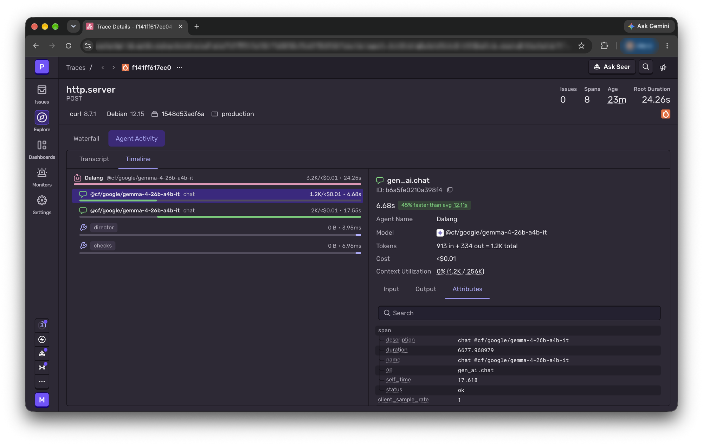
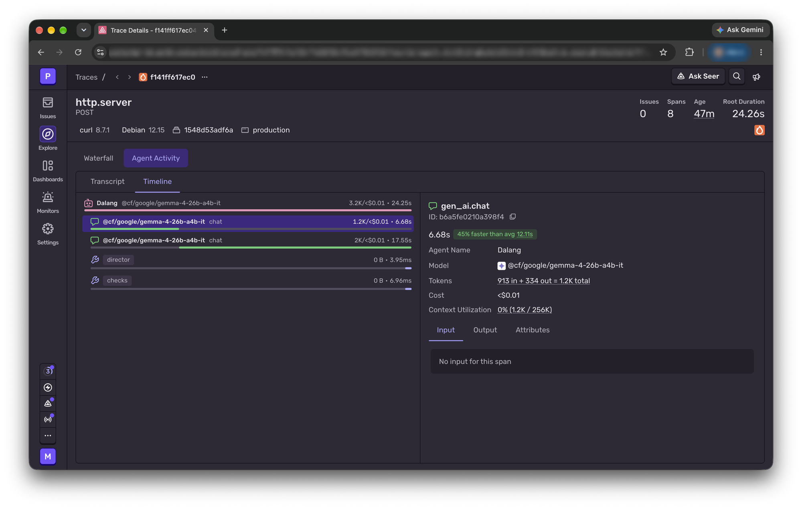

# DEV post: material to use

Working notes for the #hf26challenge write-up. Numbers come from real runs; keep them honest.

## Sentry agent trace (Best Use of Sentry Agent Tracing)

Caption idea: *One story, traced. The dalang is an agent with two tools: the director, which turns the model's storyboard into a timed play, and the checks, which find problems for a repair round.*

From this run (live site, fictional test story, 2026-10-28):
- whole run 24.25 s, 3.2K tokens, under $0.01
- casting call 6.68 s (913 in / 334 out), scenes call 17.55 s
- director 3.95 ms, checks 6.96 ms: the model takes seconds, our own code takes milliseconds
- no story text, prompts or model output are sent to Sentry (only models, token counts, timings and costs)

Privacy proof, same span with the Input tab open: "No input for this span".

## Eval: what made real Gemma 4 work

- first attempt on Cloudflare Gemma 4: 2 of 3 stories fell back to the demo play
- after fixes (forgiving schema, repair prompts that repeat the story and cast, a director bug in `cross`): 12 of 12 real plays, 58% first try
- small local model for contrast: gemma3:1b fell back on 3 of 3 stories (before the robustness fixes)
- offline ladder, same 12 stories, current code, on an 8 GB MacBook (Ollama):
  - gemma3:1b: 12 of 12 fell back to the demo play (p50 27 s); it never wrote a valid cast
  - gemma3:4b: 4 of 12 real plays, 8 fell back, 0% first try, p50 4 min 11 s / p90 5 min 16 s
  - qwen3.5:4b, untrained: 0 real plays (11 stories ran fully; the 12th was cut off when the local server stopped), avg 1.7 repair rounds, p50 2 min 14 s
  - Gemma 4 26B (Cloudflare): 12 of 12 real plays, 75% first try, p50 25 s
  - Qwen3.5-4B apprentice (LoRA on Tinker, run through Tinker's endpoint): 10 of 12 real plays, all 10 on the first try (83%), 2 fell back; p50 8.9 s; 13.8 distinct moves per play (Gemma 4: 12.9)
  - why the 2 misses stay misses: the apprentice only ever saw first-try answers, never a repair round, so when it slips it can't fix itself; Gemma 4 can
  - training: 182 examples, 3 passes, ~$0.50 of Tinker credit; held-out loss 0.61 -> 0.38
  - local run of the apprentice on an 8 GB M1 (Ollama, nvfp4, 4.4 GB): answers correctly but 1-5 min per call; a full 12-story run froze the Mac (watchdog panic), so the 12-story number comes from the cloud run
- teacher data: Gemma 4 invented 169 practice stories and performed 98 before the free daily allowance ran out; 91 passed every check (53 on the first try) = 182 training examples

Image hosting: upload images through the DEV editor, or link them from `main` after the branch merges (branch links break when the branch is deleted).
